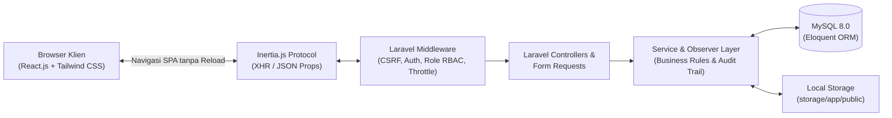

# System Architecture & Codebase Blueprint
## SIMBANGDES — Sistem Informasi Manajemen Pembangunan dan Transparansi Desa

Dokumen ini menjelaskan pola arsitektur aplikasi, alur komunikasi klien-server, struktur direktori proyek, mekanisme otorisasi RBAC, serta arsitektur keamanan yang menjadi acuan implementasi kode.

---

## 1. Pola Arsitektur: *Monolith-Hybrid* (Laravel + Inertia + React)

SIMBANGDES menerapkan arsitektur **Monolith-Hybrid** di mana seluruh perutean (*routing*), autentikasi sesi, otorisasi, dan kueri basis data dikelola oleh Laravel di sisi server, sementara lapisan tampilan dirender secara dinamis di sisi klien menggunakan komponen React melalui jembatan **Inertia.js**.



### Keuntungan Teknis Pendekatan Ini:
1. **Tanpa Overhead REST/GraphQL API:** *Controller* langsung mengembalikan `Inertia::render('Folder/Komponen', ['data' => $data])` tanpa perlu serialisasi token JWT atau pengelolaan CORS yang kompleks.
2. **Keamanan Sesi Bawaan:** Menggunakan mekanisme sesi dan *CSRF protection* standar Laravel yang teruji.
3. **Pengalaman Pengguna SPA:** Perpindahan antarhalaman berlangsung cepat tanpa memuat ulang aset CSS/JS secara keseluruhan.

---

## 2. Struktur Direktori Proyek (*Folder Structure*)

Gunakan struktur direktori berikut agar pemisahan tanggung jawab (*Separation of Concerns*) antarperan tetap bersih:

```text
simbangdes/
├── app/
│   ├── Http/
│   │   ├── Controllers/
│   │   │   ├── Auth/                  # LoginController, LogoutController
│   │   │   ├── Public/                # BerandaController, ProyekPublikController, PetaController, PengaduanPublikController
│   │   │   ├── Pemdes/                # DashboardPemdesController, ProyekController, AnggaranController, VerifikasiLaporanController, PengaduanAdminController, LaporanPdfController
│   │   │   ├── Pelaksana/             # DashboardPelaksanaController, ProyekTugasController, LaporanProgresController
│   │   │   ├── Admin/                 # DashboardAdminController, UserManagementController, AuditTrailController, BackupController
│   │   │   └── ProfileController.php  # Manajemen profil bersama (admin, pemdes, pelaksana)
│   │   ├── Middleware/
│   │   │   ├── CheckRole.php          # Middleware pembatas akses berdasarkan role statis
│   │   │   ├── CheckActiveUser.php    # Memastikan status_aktif == true pada setiap request
│   │   │   └── HandleInertiaRequests.php
│   │   └── Requests/                  # FormRequest validasi (StoreProyekRequest, StoreLaporanRequest, dll.)
│   ├── Models/                        # User, Proyek, Anggaran, TransaksiPengeluaran, LaporanProgres, DokumentasiFoto, PengaduanMasyarakat, LogAktivitas
│   ├── Observers/                     # AuditTrailObserver, TransaksiPengeluaranObserver
│   └── Services/                      # KalkulasiAnggaranService, AnalisisRisikoService, ImageCompressionService, TiketPengaduanService
├── database/
│   ├── migrations/                    # 8 file migrasi sesuai urutan di DATABASE.md
│   └── seeders/                       # Akun default admin, pemdes, pelaksana, dan data simulasi desa
├── resources/
│   ├── js/
│   │   ├── Components/                # Komponen UI reusable (StatusBadge, MoneyFormat, MapPicker, PhotoUploader, Modal, Pagination)
│   │   ├── Layouts/
│   │   │   ├── PublicLayout.jsx       # Navbar merah-putih publik & footer informasi desa
│   │   │   └── AuthenticatedLayout.jsx # Sidebar gelap (slate) dinamis sesuai auth.user.role
│   │   └── Pages/
│   │       ├── Auth/                  # Login.jsx
│   │       ├── Public/                # Home.jsx, ProyekIndex.jsx, ProyekShow.jsx, Peta.jsx, Transparansi.jsx, Pengaduan.jsx
│   │       ├── Pemdes/                # Dashboard.jsx, Proyek/, Keuangan/, Monitoring/, Laporan/, Pengaduan/
│   │       ├── Pelaksana/             # Dashboard.jsx, Proyek/, Laporan/
│   │       ├── Admin/                 # Dashboard.jsx, Users/, AuditTrail/, Pemeliharaan/
│   │       └── Profile/               # Edit.jsx
│   └── views/
│       ├── app.blade.php              # Root template Inertia
│       └── pdf/                       # Template Blade khusus ekspor Dompdf (rekap_proyek.blade.php)
└── routes/
    └── web.php                        # Seluruh definisi rute dikelompokkan berdasarkan prefix & middleware role
```

---

## 3. Arsitektur Routing & Kontrol Akses (RBAC)

### 3.1 Pengelompokan Rute (`routes/web.php`)
Seluruh rute web dibagi menjadi empat grup utama:
1. **Grup Publik (`middleware(['web'])`):** Dapat diakses siapa saja tanpa autentikasi (`/`, `/proyek`, `/proyek/{kode_proyek}`, `/peta`, `/transparansi`, `/pengaduan`, `/pengaduan/cek-tiket`).
2. **Grup Pemerintah Desa (`middleware(['auth', 'active', 'role:pemdes'])`, prefix `/pemdes`):** Seluruh rute manajemen proyek, keuangan, monitoring risiko, verifikasi laporan, tindak lanjut aduan, dan ekspor PDF.
3. **Grup Pelaksana Proyek (`middleware(['auth', 'active', 'role:pelaksana'])`, prefix `/pelaksana`):** Rute melihat proyek yang ditugaskan (`where('pelaksana_id', auth()->id())`), mengirim laporan progres, mengunggah foto, dan merevisi laporan ditolak.
4. **Grup Admin Sistem (`middleware(['auth', 'active', 'role:admin'])`, prefix `/admin`):** Rute CRUD pengguna, melihat log aktivitas (*Audit Trail*), melihat sesi aktif, dan menjalankan *backup* database.

### 3.2 Shared Inertia Props (`HandleInertiaRequests.php`)
Setiap respons Inertia menyertakan objek global berikut agar dapat diakses seluruh komponen React:
* `auth.user`: `{ id, nama_lengkap, username, email, role }` (bernilai `null` jika tamu publik).
* `flash`: `{ success, error, warning, ticket_code }` untuk menampilkan notifikasi *toast* otomatis setelah aksi formulir.

---

## 4. Arsitektur Keamanan Berlapis (*Defense in Depth*)

1. **Autentikasi & Perlindungan Sesi:**
   * Kata sandi disimpan dengan algoritma **Bcrypt** (`Hash::make()`).
   * *Middleware* `CheckActiveUser` otomatis melakukan `Auth::logout()` dan mengarahkan ke halaman login jika Admin menonaktifkan akun pengguna saat sesi sedang berlangsung.
   * Perlindungan *Brute-Force* menggunakan `throttle:5,1` (maksimal 5 percobaan gagal per menit) pada endpoint `POST /login`.
2. **Validasi Input & Pencegahan Injeksi:**
   * Seluruh input HTTP divalidasi menggunakan kelas *Form Request* Laravel (mengembalikan kode HTTP `422` beserta pesan kesalahan spesifik ke Inertia).
   * Kueri database menggunakan Eloquent ORM dan *Parameter Binding* untuk mencegah *SQL Injection*.
   * React secara otomatis melakukan *escaping* pada variabel JSX untuk mencegah *Cross-Site Scripting* (XSS).
3. **Keamanan Unggah Berkas (*File Upload Security*):**
   * Validasi ketat pada tipe MIME aktual (`mimes:jpg,jpeg,png,webp` untuk foto; `mimes:jpg,jpeg,png,pdf` untuk nota transaksi) dan batas ukuran `max:5120` (5 MB).
   * Berkas disimpan menggunakan nama teracak (`Str::uuid()`) di luar direktori eksekusi skrip PHP (`storage/app/public/dokumentasi/...`).
4. **Keamanan Ekspor PDF (Mitigasi SSRF):**
   * Pustaka `Dompdf` dikonfigurasi dengan `isRemoteEnabled = false` dan hanya merender gambar lokal melalui jalur `public_path()` atau `storage_path()`.
5. **Proteksi Formulir Publik:**
   * Endpoint pengiriman pengaduan publik dilindungi validasi **CAPTCHA** dan `throttle:3,1` (maksimal 3 pengaduan per menit per alamat IP).