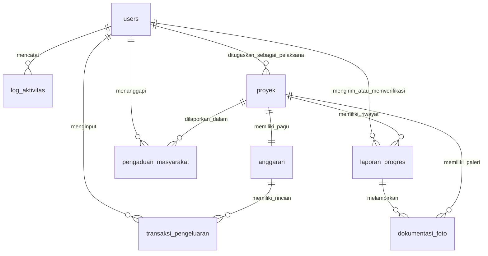

# Database Design & Schema Specification
## SIMBANGDES — Sistem Informasi Manajemen Pembangunan dan Transparansi Desa

| Atribut Teknis | Spesifikasi |
| :--- | :--- |
| **DBMS & Versi** | MySQL `v8.0+` / MariaDB `v10.6+` |
| **Storage Engine** | `InnoDB` (Wajib untuk dukungan transaksi ACID dan *Foreign Key*) |
| **Character Set & Collation** | `utf8mb4` / `utf8mb4_unicode_ci` |
| **ORM Framework** | Laravel Eloquent ORM (Laravel `v13.x`) |
| **Total Entitas / Tabel** | 8 Tabel Utama (Sesuai SDD Bab III.F) |

> **Catatan Penyelarasan dengan SDD Asli:**  
> Seluruh tabel dan kolom di bawah ini mengacu langsung pada rancangan asli **SDD Bab III.F** tanpa penambahan kolom ekstra di luar dokumen, kecuali **5 perbaikan teknis wajib** agar aplikasi tidak *error* saat dijalankan:
> 1. Penambahan kolom `email` dan penghapusan opsi role `Masyarakat` pada tabel `users` (menyelaraskan SDD Bab III.F dengan *Sequence Diagram*, *Class Diagram*, dan *Mockup Login*).
> 2. Perubahan tipe data `persentase_fisik` pada `laporan_progres` dari `INT` menjadi `DECIMAL(5,2)` (memenuhi standar presisi 2 digit desimal pada SRS NFR #5).
> 3. Penambahan kolom `foto_bukti` dan `kode_tiket` pada `pengaduan_masyarakat` (menyelaraskan tabel dengan *Flowchart* dan *Mockup Pengaduan*).
> 4. Penyeragaman nama tabel `laporan_progres` dan `dokumentasi_foto` di seluruh migrasi.
> 5. Penambahan 4 kolom yang dibutuhkan `BUSINESS-RULES.md` dan `PRD.md`: `proyek.target_progres`, `proyek.is_public`, `proyek.kategori`, dan `laporan_progres.verified_at` (lihat `PROGRESS.md` K-1).

---

## 1. Konvensi & Standar Basis Data

1. **Penamaan Tabel & Kolom:** Menggunakan format `snake_case` yang konsisten di seluruh migrasi Laravel dan model Eloquent.
2. **Primary Key:** Seluruh tabel menggunakan `id` bertipe `BIGINT UNSIGNED AUTO_INCREMENT`.
3. **Presisi Finansial:** Seluruh kolom nominal uang menggunakan `DECIMAL(15,2)`. Dilarang menggunakan `FLOAT` atau `DOUBLE`.
4. **Presisi Persentase & Koordinat:**
   * Persentase progres fisik menggunakan `DECIMAL(5,2)` (`0.00` s.d. `100.00`).
   * Koordinat geografis menggunakan `DECIMAL(10,8)` untuk `latitude` dan `DECIMAL(11,8)` untuk `longitude`.

---

## 2. Entity Relationship Diagram (ERD)

---

## 3. Urutan Eksekusi Migrasi Laravel (*Migration Order*)

Jalankan file migrasi sesuai urutan ketergantungan *Foreign Key* berikut:

1. `create_users_table`
2. `create_log_aktivitas_table`
3. `create_proyek_table`
4. `create_anggaran_table`
5. `create_transaksi_pengeluaran_table`
6. `create_laporan_progres_table`
7. `create_dokumentasi_foto_table`
8. `create_pengaduan_masyarakat_table`

---

## 4. Spesifikasi Struktur Tabel Detail (8 Tabel SDD + 1 Tabel Tambahan K-3)

### 4.1 Tabel `users`
Menyimpan data akun pengguna terautentikasi (`admin`, `pemdes`, `pelaksana`). Masyarakat mengakses portal publik tanpa akun.

| Nama Kolom | Tipe Data | Constraint & Index | Default | Keterangan |
| :--- | :--- | :--- | :--- | :--- |
| `id` | `BIGINT UNSIGNED` | `PRIMARY KEY`, `AUTO_INCREMENT` | - | ID unik pengguna |
| `nama_lengkap` | `VARCHAR(100)` | `NOT NULL` | - | Nama lengkap pengguna |
| `username` | `VARCHAR(50)` | `NOT NULL`, `UNIQUE` | - | Nama pengguna untuk login |
| `email` | `VARCHAR(100)` | `NOT NULL`, `UNIQUE` | - | Alamat email untuk login *(perbaikan sinkronisasi)* |
| `password` | `VARCHAR(255)` | `NOT NULL` | - | Kata sandi terenkripsi Bcrypt |
| `role` | `ENUM('admin','pemdes','pelaksana')` | `NOT NULL`, `INDEX` | `'pelaksana'` | Peran statis sistem (RBAC) |
| `status_aktif` | `BOOLEAN` (`TINYINT(1)`) | `NOT NULL` | `1` (`true`) | `1` = Aktif, `0` = Nonaktif |
| `remember_token` | `VARCHAR(100)` | `NULL` | `NULL` | Token sesi autentikasi Laravel |
| `created_at` | `TIMESTAMP` | `NULL` | `NULL` | Waktu pembuatan akun |
| `updated_at` | `TIMESTAMP` | `NULL` | `NULL` | Waktu pembaruan terakhir |

### 4.2 Tabel `log_aktivitas`
Menyimpan rekam jejak aktivitas pengguna (*Audit Trail*) yang bersifat *read-only* (sesuai SDD Bab III.F).

| Nama Kolom | Tipe Data | Constraint & Index | Default | Keterangan |
| :--- | :--- | :--- | :--- | :--- |
| `id` | `BIGINT UNSIGNED` | `PRIMARY KEY`, `AUTO_INCREMENT` | - | ID unik log |
| `user_id` | `BIGINT UNSIGNED` | `NULL`, `FOREIGN KEY` -> `users(id)` (`ON DELETE SET NULL`) | `NULL` | Pengguna yang melakukan aktivitas |
| `aktivitas` | `VARCHAR(255)` | `NOT NULL` | - | Deskripsi aktivitas yang dilakukan |
| `ip_address` | `VARCHAR(45)` | `NULL` | `NULL` | Alamat IP pengguna |
| `created_at` | `TIMESTAMP` | `NOT NULL`, `INDEX` | `CURRENT_TIMESTAMP` | Waktu aktivitas tercatat |

### 4.3 Tabel `proyek`
Menyimpan data master proyek pembangunan desa beserta lokasi koordinat dan progres aktual terkini.

| Nama Kolom | Tipe Data | Constraint & Index | Default | Keterangan |
| :--- | :--- | :--- | :--- | :--- |
| `id` | `BIGINT UNSIGNED` | `PRIMARY KEY`, `AUTO_INCREMENT` | - | ID unik proyek |
| `nama_proyek` | `VARCHAR(150)` | `NOT NULL` | - | Nama kegiatan pembangunan |
| `lokasi` | `VARCHAR(200)` | `NOT NULL` | - | Lokasi pelaksanaan proyek |
| `latitude` | `DECIMAL(10,8)` | `NULL` | `NULL` | Koordinat lintang untuk peta Leaflet.js |
| `longitude` | `DECIMAL(11,8)` | `NULL` | `NULL` | Koordinat bujur untuk peta Leaflet.js |
| `pelaksana_id` | `BIGINT UNSIGNED` | `NOT NULL`, `FOREIGN KEY` -> `users(id)` (`ON DELETE RESTRICT`) | - | Pelaksana proyek (`role = 'pelaksana'`) |
| `tanggal_mulai` | `DATE` | `NOT NULL` | - | Tanggal mulai proyek |
| `tanggal_selesai` | `DATE` | `NOT NULL`, `INDEX` | - | Tenggat waktu (*deadline*) proyek |
| `progres_aktual` | `DECIMAL(5,2)` | `NOT NULL` | `0.00` | Persentase progres fisik terakhir yang disetujui |
| `target_progres` | `DECIMAL(5,2)` | `NOT NULL` | `100.00` | Target progres akhir proyek *(perbaikan #5)* |
| `is_public` | `BOOLEAN` (`TINYINT(1)`) | `NOT NULL`, `INDEX` | `1` (`true`) | Tampil di portal publik atau internal saja *(perbaikan #5)* |
| `kategori` | `VARCHAR(100)` | `NULL` | `NULL` | Jenis/kategori proyek untuk filter katalog *(perbaikan #5)* |
| `status_proyek` | `ENUM('Perencanaan','Berjalan','Terlambat','Selesai')` | `NOT NULL`, `INDEX` | `'Perencanaan'` | Status pelaksanaan proyek |
| `deskripsi` | `TEXT` | `NULL` | `NULL` | Deskripsi detail proyek |
| `created_at` | `TIMESTAMP` | `NULL` | `NULL` | Waktu dibuat |
| `updated_at` | `TIMESTAMP` | `NULL` | `NULL` | Waktu diperbarui |

### 4.4 Tabel `anggaran`
Menyimpan alokasi pagu dan ringkasan realisasi dana per proyek (relasi 1-ke-1 dengan `proyek`).

| Nama Kolom | Tipe Data | Constraint & Index | Default | Keterangan |
| :--- | :--- | :--- | :--- | :--- |
| `id` | `BIGINT UNSIGNED` | `PRIMARY KEY`, `AUTO_INCREMENT` | - | ID unik anggaran |
| `proyek_id` | `BIGINT UNSIGNED` | `NOT NULL`, `UNIQUE`, `FOREIGN KEY` -> `proyek(id)` (`ON DELETE CASCADE`) | - | Relasi 1-ke-1 ke proyek |
| `tahun_anggaran` | `YEAR` | `NOT NULL`, `INDEX` | - | Tahun anggaran (misal: `2026`) |
| `sumber_dana` | `VARCHAR(100)` | `NOT NULL` | - | Sumber dana (misal: `Dana Desa`, `ADD`) |
| `pagu_anggaran` | `DECIMAL(15,2)` | `NOT NULL` | `0.00` | Total pagu dana proyek |
| `total_realisasi` | `DECIMAL(15,2)` | `NOT NULL` | `0.00` | Akumulasi otomatis dari `transaksi_pengeluaran.nominal` |
| `sisa_anggaran` | `DECIMAL(15,2)` | `NOT NULL` | `0.00` | Hasil kalkulasi `pagu_anggaran - total_realisasi` |
| `created_at` | `TIMESTAMP` | `NULL` | `NULL` | Waktu dibuat |
| `updated_at` | `TIMESTAMP` | `NULL` | `NULL` | Waktu diperbarui |

### 4.5 Tabel `transaksi_pengeluaran`
Mencatat rincian transaksi realisasi anggaran proyek beserta bukti nota/kwitansi.

| Nama Kolom | Tipe Data | Constraint & Index | Default | Keterangan |
| :--- | :--- | :--- | :--- | :--- |
| `id` | `BIGINT UNSIGNED` | `PRIMARY KEY`, `AUTO_INCREMENT` | - | ID unik transaksi |
| `anggaran_id` | `BIGINT UNSIGNED` | `NOT NULL`, `FOREIGN KEY` -> `anggaran(id)` (`ON DELETE CASCADE`) | - | Referensi ke anggaran proyek |
| `tanggal_transaksi` | `DATE` | `NOT NULL`, `INDEX` | - | Tanggal pengeluaran |
| `uraian` | `VARCHAR(200)` | `NOT NULL` | - | Keterangan item pengeluaran |
| `nominal` | `DECIMAL(15,2)` | `NOT NULL` | - | Nilai pengeluaran dalam Rupiah |
| `bukti_transaksi` | `VARCHAR(255)` | `NULL` | `NULL` | Path file bukti nota/kwitansi (maks 5 MB) |
| `created_by` | `BIGINT UNSIGNED` | `NOT NULL`, `FOREIGN KEY` -> `users(id)` (`ON DELETE RESTRICT`) | - | User Pemdes yang menginput transaksi |
| `created_at` | `TIMESTAMP` | `NULL` | `NULL` | Waktu pencatatan |
| `updated_at` | `TIMESTAMP` | `NULL` | `NULL` | Waktu pembaruan |

### 4.6 Tabel `laporan_progres`
Menyimpan laporan perkembangan fisik dari Pelaksana beserta status verifikasi dan catatan revisi dari Pemdes.

| Nama Kolom | Tipe Data | Constraint & Index | Default | Keterangan |
| :--- | :--- | :--- | :--- | :--- |
| `id` | `BIGINT UNSIGNED` | `PRIMARY KEY`, `AUTO_INCREMENT` | - | ID unik laporan |
| `proyek_id` | `BIGINT UNSIGNED` | `NOT NULL`, `FOREIGN KEY` -> `proyek(id)` (`ON DELETE CASCADE`) | - | Proyek yang dilaporkan |
| `pelaksana_id` | `BIGINT UNSIGNED` | `NOT NULL`, `FOREIGN KEY` -> `users(id)` (`ON DELETE RESTRICT`) | - | Pelaksana pengirim laporan |
| `tanggal_laporan` | `DATE` | `NOT NULL`, `INDEX` | - | Tanggal laporan lapangan |
| `persentase_fisik` | `DECIMAL(5,2)` | `NOT NULL` | - | Persentase progres fisik (`0.00` - `100.00`) |
| `keterangan` | `TEXT` | `NOT NULL` | - | Uraian pekerjaan yang dilaksanakan |
| `kendala` | `TEXT` | `NULL` | `NULL` | Catatan kendala lapangan (opsional) |
| `status_verifikasi` | `ENUM('Menunggu','Disetujui','Ditolak')` | `NOT NULL`, `INDEX` | `'Menunggu'` | Status verifikasi Pemdes |
| `catatan_revisi` | `TEXT` | `NULL` | `NULL` | Alasan pengembalian/revisi dari Pemdes |
| `verified_by` | `BIGINT UNSIGNED` | `NULL`, `FOREIGN KEY` -> `users(id)` (`ON DELETE SET NULL`) | `NULL` | User Pemdes yang memverifikasi |
| `verified_at` | `TIMESTAMP` | `NULL` | `NULL` | Waktu verifikasi *(perbaikan #5)* |
| `created_at` | `TIMESTAMP` | `NULL` | `NULL` | Waktu laporan dikirim |
| `updated_at` | `TIMESTAMP` | `NULL` | `NULL` | Waktu laporan diverifikasi/diperbarui |

### 4.7 Tabel `dokumentasi_foto`
Menyimpan foto dokumentasi lapangan dalam 3 tahap pengerjaan (`Sebelum`, `Saat`, `Sesudah`).

| Nama Kolom | Tipe Data | Constraint & Index | Default | Keterangan |
| :--- | :--- | :--- | :--- | :--- |
| `id` | `BIGINT UNSIGNED` | `PRIMARY KEY`, `AUTO_INCREMENT` | - | ID unik foto |
| `laporan_id` | `BIGINT UNSIGNED` | `NOT NULL`, `FOREIGN KEY` -> `laporan_progres(id)` (`ON DELETE CASCADE`) | - | Relasi ke laporan progres |
| `proyek_id` | `BIGINT UNSIGNED` | `NOT NULL`, `FOREIGN KEY` -> `proyek(id)` (`ON DELETE CASCADE`) | - | Relasi ke proyek |
| `tahap` | `ENUM('Sebelum','Saat','Sesudah')` | `NOT NULL`, `INDEX` | - | Tahap pengambilan foto |
| `file_path` | `VARCHAR(255)` | `NOT NULL` | - | Path berkas foto di storage |
| `created_at` | `TIMESTAMP` | `NOT NULL` | `CURRENT_TIMESTAMP` | Waktu unggah foto |

### 4.8 Tabel `pengaduan_masyarakat`
Menyimpan pengaduan publik beserta foto bukti dan kode tiket pelacakan.

| Nama Kolom | Tipe Data | Constraint & Index | Default | Keterangan |
| :--- | :--- | :--- | :--- | :--- |
| `id` | `BIGINT UNSIGNED` | `PRIMARY KEY`, `AUTO_INCREMENT` | - | ID unik pengaduan |
| `kode_tiket` | `VARCHAR(20)` | `NOT NULL`, `UNIQUE` | - | Kode tiket pelacakan warga *(perbaikan sinkronisasi)* |
| `proyek_id` | `BIGINT UNSIGNED` | `NULL`, `FOREIGN KEY` -> `proyek(id)` (`ON DELETE SET NULL`) | `NULL` | Opsional jika terkait proyek tertentu |
| `nama_pelapor` | `VARCHAR(100)` | `NOT NULL` | - | Nama warga pelapor |
| `kontak_pelapor` | `VARCHAR(50)` | `NULL` | `NULL` | Nomor HP/Email pelapor (opsional) |
| `lokasi_kejadian` | `VARCHAR(200)` | `NOT NULL` | - | Lokasi kejadian yang diadukan |
| `isi_pengaduan` | `TEXT` | `NOT NULL` | - | Detail pengaduan masyarakat |
| `foto_bukti` | `VARCHAR(255)` | `NULL` | `NULL` | Path foto bukti pengaduan *(perbaikan sinkronisasi)* |
| `status_pengaduan` | `ENUM('Menunggu','Diproses','Selesai','Ditolak')` | `NOT NULL`, `INDEX` | `'Menunggu'` | Status penanganan oleh Pemdes |
| `tanggapan_pemdes` | `TEXT` | `NULL` | `NULL` | Tanggapan resmi dari Pemdes |
| `ditanggapi_oleh` | `BIGINT UNSIGNED` | `NULL`, `FOREIGN KEY` -> `users(id)` (`ON DELETE SET NULL`) | `NULL` | User Pemdes yang menanggapi |
| `created_at` | `TIMESTAMP` | `NULL` | `NULL` | Waktu pengaduan dikirim |
| `updated_at` | `TIMESTAMP` | `NULL` | `NULL` | Waktu tanggapan diperbarui |

### 4.9 Tabel `berita_pengumuman` (tambahan K-3, 2026-11-21)
Konten Berita & Pengumuman desa yang dikelola Pemdes dan ditampilkan di Portal Publik. Migration: `2026_11_21_013940_create_berita_pengumuman_table.php` (urutan ke-9, setelah `pengaduan_masyarakat`).

| Nama Kolom | Tipe Data | Constraint & Index | Default | Keterangan |
| :--- | :--- | :--- | :--- | :--- |
| `id` | `BIGINT UNSIGNED` | `PRIMARY KEY`, `AUTO_INCREMENT` | - | ID unik |
| `user_id` | `BIGINT UNSIGNED` | `NOT NULL`, `FOREIGN KEY` -> `users(id)` (`ON DELETE RESTRICT`) | - | Penulis (Pemdes) |
| `judul` | `VARCHAR(200)` | `NOT NULL` | - | Judul |
| `slug` | `VARCHAR(220)` | `NOT NULL`, `UNIQUE` | - | Dibuat sekali saat create, tidak berubah saat judul diedit |
| `kategori` | `ENUM('Berita','Pengumuman')` | `NOT NULL`, `INDEX` | - | Jenis konten |
| `ringkasan` | `VARCHAR(300)` | `NOT NULL` | - | Teks kartu dan meta deskripsi |
| `konten` | `TEXT` | `NOT NULL` | - | Teks polos (tanpa HTML) |
| `gambar_cover` | `VARCHAR(255)` | `NULL` | `NULL` | Path WebP di disk `public` (`berita/*.webp`) |
| `is_published` | `BOOLEAN` | `NOT NULL` | `0` | Status terbit |
| `published_at` | `TIMESTAMP` | `NULL` | `NULL` | Waktu terbit; publik hanya melihat `is_published = 1` dan `published_at <= now()` |
| `created_at`, `updated_at` | `TIMESTAMP` | `NULL` | `NULL` | Standar Laravel. `INDEX (is_published, published_at)` |

### 4.10 Tabel `rab_komponen` (tambahan K-4, 2026-11-22)
Rincian komponen rencana anggaran per proyek (satu `anggaran` per proyek). Migration: `2026_11_22_000001_create_rab_komponen_table.php`.

| Nama Kolom | Tipe Data | Constraint & Index | Default | Keterangan |
| :--- | :--- | :--- | :--- | :--- |
| `id` | `BIGINT UNSIGNED` | `PRIMARY KEY`, `AUTO_INCREMENT` | - | ID unik |
| `anggaran_id` | `BIGINT UNSIGNED` | `NOT NULL`, `FOREIGN KEY` -> `anggaran(id)` (`ON DELETE CASCADE`) | - | Anggaran induk |
| `nama_komponen` | `VARCHAR(100)` | `NOT NULL`, `UNIQUE (anggaran_id, nama_komponen)` | - | Material, Tenaga Kerja, Transportasi, dst. |
| `nominal_rencana` | `DECIMAL(15,2)` | `NOT NULL` | - | Total per anggaran tidak boleh melebihi `pagu_anggaran` |
| `created_at`, `updated_at` | `TIMESTAMP` | `NULL` | `NULL` | Standar Laravel |

Kolom tambahan K-4 pada tabel lain:
- `transaksi_pengeluaran.rab_komponen_id` — `BIGINT UNSIGNED NULL`, FK -> `rab_komponen(id)` (`ON DELETE SET NULL`). `NULL` = "Tanpa Komponen". Migration `2026_11_22_000002_*`.
- `log_aktivitas.proyek_id` — `BIGINT UNSIGNED NULL`, `INDEX (proyek_id, id)`, **tanpa FK** (agar audit trail tetap append-only). Migration `2026_11_22_000003_*`.
